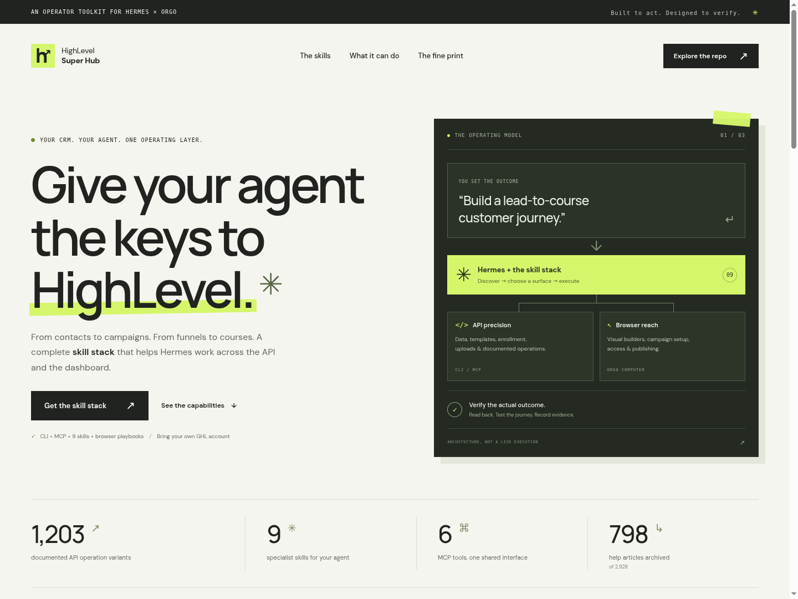

# HighLevel Super Hub

**Give your agent the keys to HighLevel.**

[here.now one-pager](https://open-spirit-656x.here.now/) · [Permanent overview](https://jbellsolutions.github.io/ghl-super-hub/) · [Download the bundle](https://github.com/jbellsolutions/ghl-super-hub/releases/latest) · [Setup guide](docs/INSTALL.md)



A portable operator bundle built from the supplied Lead Gen Jay CLI: API tools,
MCP, nine agent skills, official documentation search, and dashboard procedures.
Hermes runs the agent; Orgo provides its computer. A separate agent service is not
required to use this bundle.

## Install in one command

```bash
curl -fsSL https://raw.githubusercontent.com/jbellsolutions/ghl-super-hub/main/install-agent.sh | bash
```

Or **drop [INSTALL-AGENT.md](INSTALL-AGENT.md) into Claude Code or Hermes** and say:
“Install this for me.” The installer detects the agent(s), verifies the release,
installs the CLI and native plugin, and checks all six MCP tools. Use
`bash -s -- --agent claude` or `bash -s -- --agent hermes` to choose one explicitly.

Start a new agent session if needed, then connect your account once:

```bash
~/.local/bin/ghl hub connect
```

The token prompt is hidden. Credentials live outside plugin caches, so updates do
not replace them. Installation works on macOS, Linux, Orgo and WSL, with an existing
Claude Code or Hermes CLI. It finds Python automatically or installs a user-local
uv-managed runtime; no sudo or shell-profile edits. Host permission prompts and
GHL/Orgo authentication still apply. No installer can guarantee zero issues on
every machine; failures stop with a concrete error.

[Full setup, native plugin commands and manual installation](docs/INSTALL.md).
Separate tenants use protected files: `ghl --env-file /secure/tenant.env ...`.

## Included

- The inherited CRM convenience commands, plus `ghl hub` for broad API discovery.
- **1,203 documented operations:** 576 original-version and 627 v3 operations,
  namespaced separately, generated from pinned official OpenAPI sources.
- Schema inspection, required-input validation, dry-run plans and explicit execution.
  JSON bodies, URL-encoded forms and multipart file uploads are supported.
- Six stdio MCP tools exposing API discovery/execution and documentation retrieval.
- Nine portable skills covering routing, APIs, browser use, workflows, sites,
  email campaigns, affiliates, community memberships and courses.
- Local full-text search over saved help articles and official API source files.
- Integration/scale design and a concrete live acceptance checklist.

## Current limits

**This is not yet 100% live-verified GHL control.** The build archived **798 of 2,928**
sitemap-listed help articles before the portal returned a Cloudflare browser-verification
challenge. The scraper stopped. [Coverage](knowledge/coverage.json) lists every missing URL;
`./ghl hub docs sync` resumes after access is available. Embedded image/video URLs are
retained, but their binary assets and video transcripts are not archived.

All official API source files in the selected upstream paths are saved at a pinned
revision. That does not imply every endpoint accepts a PIT or every account has every
feature. No GHL credentials, logged-in browser or Orgo computer were supplied, so live
account permissions, browser procedures and production workflows remain unverified.
OAuth refresh, a hosted webhook receiver, durable queues and fleet orchestration are
specified in the integration design, not implemented services.

The official APIs do not expose every builder. Workflow graphs, page authoring,
broadcast scheduling, affiliate campaign setup and community/course management need
browser procedures for the gaps. A new integration token cannot add an unpublished
endpoint. [Capabilities and gaps](docs/CAPABILITIES.md) records these distinctions.

## Reference

- [Installation](docs/INSTALL.md)
- [Capabilities and browser procedure links](docs/CAPABILITIES.md)
- [API inventory](docs/API-INVENTORY.md)
- [OAuth, webhooks and scale](docs/INTEGRATIONS.md)
- [Live acceptance checklist](docs/ACCEPTANCE.md)
- [Build and validation status](docs/BUILD-STATUS.md)
- [Sources and provenance](docs/SOURCES.md)

Refresh API sources with `.venv/bin/python scripts/import_api.py`, then regenerate
coverage with `.venv/bin/python scripts/coverage_report.py`. Refresh help with
`./ghl hub docs sync`; use `--refresh` explicitly to replace already archived articles.
The scraper respects the published robots rules, paces requests, backs off on 429,
and stops on a browser challenge. It never treats a challenge page as a help article.

```bash
.venv/bin/python -m unittest discover -s tests -v
.venv/bin/python scripts/build_bundle.py
```

The inherited experimental Firebase workflow tools remain opt-in and are excluded
from hub MCP. Personalized upstream builders, account exports and the private workspace history
are excluded from the public repository and portable distribution.
See [sources and provenance](docs/SOURCES.md) for upstream attribution.
